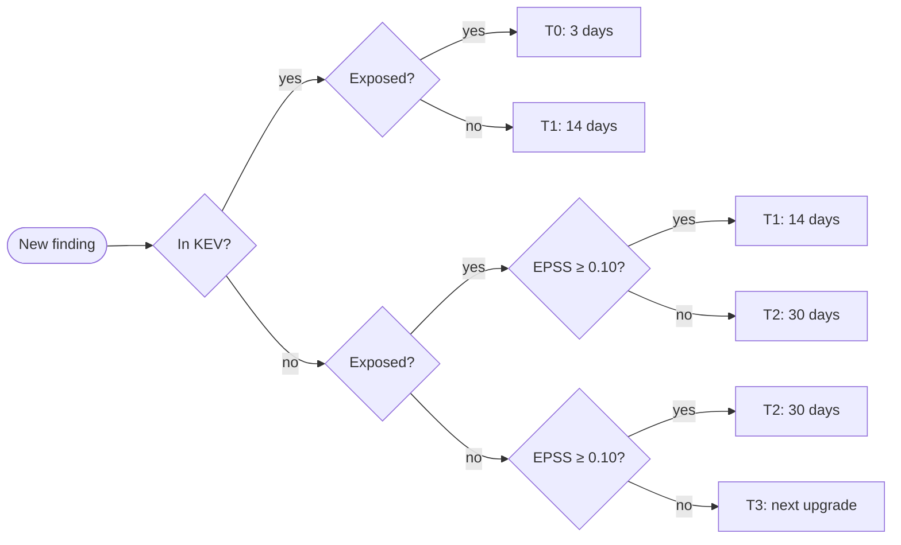

# ssdlc-triage

Put CVEs into **fix-by tiers** using three facts a scanner does not give you on its own:

| Fact | Source | Question it answers |
|---|---|---|
| In KEV? | [CISA Known Exploited Vulnerabilities](https://www.cisa.gov/known-exploited-vulnerabilities-catalog) | Is it being exploited right now? |
| EPSS score | [FIRST EPSS](https://www.first.org/epss/) | How likely is exploitation in the next 30 days? |
| Exposed? | You (your service catalogue) | Can an attacker on the internet reach it? |

A CVSS score says how bad a bug *could* be. These three say how fast *this* one, in *this* service, has to be fixed.
The same CVE can be a 3-day emergency on an internet-facing API and a 14-day item on an internal batch job.

Companion to the post [SSDLC when exploits are cheap](https://samarthya.me/posts/ssdlc-in-the-age-of-ai-exploits/).

## The policy

| Tier | Rule (first match wins) | Fix within |
|---|---|---|
| **T0** | in KEV **and** exposed | 3 days |
| **T1** | in KEV, **or** exposed with EPSS ≥ 0.10 | 14 days |
| **T2** | EPSS ≥ 0.10, **or** exposed | 30 days |
| **T3** | none of the above | next planned upgrade |



It is loosely modelled on CISA [BOD 26-04](https://www.cisa.gov/news-events/directives/bod-26-04-prioritizing-security-updates-based-risk), which asks about exposure, known exploitation,
automatability and impact. The whole policy is the `tier()` function in [`triage.py`](triage.py): about ten lines,
written to be read and argued about by your team. That is the point of policy as code.

## Requirements

- Python **3.12 or later** (it uses `itertools.batched` and `type` aliases)
- No third-party packages: only the standard library
- Network access to `www.cisa.gov` and `api.first.org`, or a downloaded KEV file (see [Air-gapped runners](#air-gapped-runners))

## Quick start

```bash
git clone https://github.com/samarthya/ssdlc-triage.git
cd ssdlc-triage
python3.12 triage.py --exposed CVE-2021-44228 CVE-2022-3602
```

```text
CVE-2021-44228     kev=True  epss=1.000  T0  fix within 3 days
CVE-2022-3602      kev=False epss=0.908  T1  fix within 14 days
```

The same two CVEs on a service that is **not** exposed:

```text
$ python3.12 triage.py CVE-2021-44228 CVE-2022-3602
CVE-2021-44228     kev=True  epss=1.000  T1  fix within 14 days
CVE-2022-3602      kev=False epss=0.908  T2  fix within 30 days
```

EPSS scores change daily, so your numbers may differ slightly.

## Usage

```text
python3.12 triage.py [CVE ...] [-f FILE] [--exposed] [--epss-threshold N]
                     [--kev-file PATH] [--format {table,json,csv}] [--fail-on {T0,T1,T2,T3}]
```

| Option | What it does |
|---|---|
| `CVE ...` | CVE IDs as arguments (case does not matter; duplicates are dropped) |
| `-f FILE` | Read CVE IDs from a file, one per line; `-` reads stdin; `#` starts a comment |
| `--exposed` | The service is reachable from the internet |
| `--epss-threshold N` | EPSS score that counts as "likely" (default `0.10`) |
| `--kev-file PATH` | Use a downloaded copy of the KEV JSON feed instead of fetching it |
| `--format` | `table` (default), `json` or `csv` |
| `--fail-on TIER` | Exit with status `1` if any CVE is in `TIER` or a more urgent one |

### From a scanner's output

Any scanner that writes JSON can feed it. For example, with [OSV-Scanner](https://github.com/google/osv-scanner) and `jq`:

```bash
osv-scanner scan source -r . --format json \
  | jq -r '.results[].packages[].vulnerabilities[] | (.id, .aliases[]?) | select(startswith("CVE-"))' \
  | python3.12 triage.py -f - --exposed --format csv > triage.csv
```

Or with [Trivy](https://github.com/aquasecurity/trivy) on a container image:

```bash
trivy image --format json -q my-app:1.4.2 \
  | jq -r '.Results[].Vulnerabilities[]?.VulnerabilityID | select(startswith("CVE-"))' \
  | python3.12 triage.py -f - --exposed
```

### As a CI gate

`--fail-on T0` fails the build only for the real emergencies, so it can be switched on from day one without
blocking everyone on old findings:

```yaml
# .github/workflows/triage.yml (works on GitHub.com and GitHub Enterprise Server self-hosted runners)
- uses: actions/setup-python@v5
  with:
    python-version: "3.12"
- name: Triage dependency CVEs
  run: |
    jq -r '.results[].packages[].vulnerabilities[] | (.id, .aliases[]?) | select(startswith("CVE-"))' osv.json \
      | python triage.py -f - --exposed --fail-on T0
```

### Air-gapped runners

On a self-hosted runner without internet access, mirror the KEV feed once a day and pass it in:

```bash
curl -sSfo kev.json https://www.cisa.gov/sites/default/files/feeds/known_exploited_vulnerabilities.json
python3.12 triage.py --kev-file kev.json -f cves.txt
```

EPSS is still fetched live. To go fully offline, mirror FIRST's
[daily EPSS CSV](https://www.first.org/epss/data_stats) and replace `load_epss()`.

## Tuning it

- **Change the deadlines** in `DEADLINES` at the top of `triage.py` to match your own policy.
- **Change the threshold** with `--epss-threshold`. After a quarter, look at how many T1/T2 findings it created
  and how many of those were ever exploited, then move it.
- **Exposure is per service, not per run.** In a real pipeline, look it up from your service catalogue and pass
  `--exposed` only for internet-facing services.
- A CVE that EPSS has not scored yet (very new) counts as `0.0`. KEV and exposure still apply.

## Tests

```bash
python3.12 -m unittest discover -s tests -v
```

The tests cover every branch of the policy and the CLI, with the feeds stubbed, so they run offline.

## Limitations

- It triages **CVE IDs only**. GHSA-only or vendor-only advisories need mapping to a CVE first.
- It does not know whether the vulnerable code is **reachable** in your application; it treats every CVE in
  the dependency tree as present.
- It is a starting point for a policy, not a compliance tool. Read [BOD 26-04](https://www.cisa.gov/news-events/directives/bod-26-04-prioritizing-security-updates-based-risk) for the
  federal requirements.

## Licence

[MIT](LICENSE)
